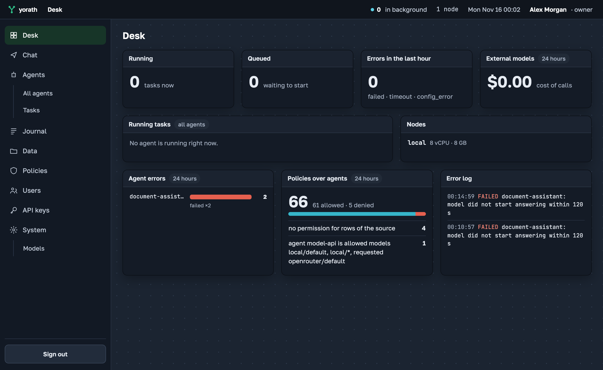

<p align="center"></p>

<h1 align="center">Yorath Operating System</h1>

<p align="center"><strong>AI Infrastructure. Finally, an OS.</strong></p>

<p align="center">
  <a href="https://yorath.io">Website</a> · <a href="https://yorath.io/docs/">Docs</a> · <a href="https://yorath.io/roadmap/">Roadmap</a> · <a href="https://github.com/yorath-os/yorath/discussions">Discussions</a>
</p>

<p align="center">
  <a href="LICENSE"></a>
  <a href="https://github.com/yorath-os/yorath/releases/latest"></a>
</p>

Yorath is an open-source operating environment for AI agents on your own server. One command installs a local model, a registry of agents, data-access policies enforced outside the model, and one journal of every call. Bring OpenClaw, Hermes, Codex or your own agents.



## Install

```sh
curl -fsSL https://get.yorath.io | sh
```

Ubuntu 24.04 x86_64, from 4 vCPU / 8 GB RAM; a GPU is needed for Codex and the connected agents. Full list: [Requirements](https://yorath.io/docs/get-started/requirements/).

Open the link the installer prints and go through the setup wizard: create the owner, pull the local model, enable the demo data. The browser warns about the certificate because Yorath issued it for the server's IP — see [Certificate](https://yorath.io/docs/operate/certificate/).

Check: in Chat, ask `document-assistant` "How many vacation days does an employee get?" — the answer cites the policy as `[1]`.

Something went wrong? Run `yorath doctor`; if that doesn't help, [open an issue](https://github.com/yorath-os/yorath/issues/new?template=install_problem.yml) with the `yorath diag` archive.

## Quick start

### Connect Codex

Needs a server with a GPU. Create a key on the API keys screen, add the provider to `~/.codex/config.toml`, then run `codex --profile yorath`:

```toml
[model_providers.yorath]
name = "Yorath"
base_url = "https://<IP>/v1"
env_key = "YORATH_API_KEY"
wire_api = "responses"
```

Full steps: [Codex CLI](https://yorath.io/docs/agents/codex-cli/).

### Add OpenClaw or Hermes

Needs a GPU and node egress control on (`yorath egress on`, the default). On the server:

```sh
yorath agent add openclaw
```

Full steps: [OpenClaw and Hermes](https://yorath.io/docs/agents/openclaw-and-hermes/).

### Call the model from your code

Any OpenAI-compatible client works with a key from the API keys screen:

```python
from openai import OpenAI

client = OpenAI(base_url="https://<address>/v1", api_key="yorath_key_…")
for chunk in client.chat.completions.create(
    model="local/default", stream=True, messages=[{"role": "user", "content": "Hello"}]
):
    print(chunk.choices[0].delta.content or "", end="")
```

Full reference: [API](https://yorath.io/docs/reference/api/).

## What you get

**Run — Minimum DevOps. Maximum value for the business.**
- Yorath detects your hardware and picks the best model for it.
- It downloads the model, runs it and keeps it working.

**Connect — Manage your own and third-party agents.**
- Install agents with Yorath.
- Install agents yourself — Yorath detects them and shows them to you.
- You know about every agent on all your servers.

Works with: OpenClaw · Hermes · Codex · Ollama · OpenRouter

**Control — Access to sensitive data is controlled by the system, not by the prompt.**
- An agent gets no access to sensitive data if its access level is not high enough.
- Built-in agents can't send sensitive data out — Yorath closes the way out automatically. A connected agent's internet is cut with one switch.
- Control of agents' internet access.

**Scale — A cluster of servers with GPUs — plug and play.**
- New servers join by token — enter it, Yorath does the rest.
- One endpoint for clients and agents — they don't need to know how many GPUs are behind it.
- Mixed servers in one cluster — for example, a server without a GPU, a server with 1 GPU and a server with 1 GPU.

## Security

- Access to data, tools and models is checked in the Gateway before the model sees anything — not in the prompt.
- Every source and model has a data class; a call that breaks it is blocked with a reason, never quietly sent to another model.
- Connected agents run in their own containers, not as root, with their own key, reaching the network only through the node's proxy.
- The Developer Agent works in a gVisor sandbox.
- Every call is in one journal.

For connected agents (OpenClaw, Hermes, Codex), Yorath sees model calls, requests to the agent and its network — not the agent's own tools. Yorath sends no telemetry.

Found a vulnerability? See [SECURITY.md](SECURITY.md): we confirm reports within 7 days. More: [yorath.io/security](https://yorath.io/security/).

## Documentation

| I want to | Read |
|---|---|
| Install and check the server | [Quickstart](https://yorath.io/docs/get-started/quickstart/) |
| Go through the wizard and the main screens | [First hour](https://yorath.io/docs/get-started/first-hour/) |
| Use Codex with the Yorath model | [Codex CLI](https://yorath.io/docs/agents/codex-cli/) |
| Run OpenClaw or Hermes | [OpenClaw and Hermes](https://yorath.io/docs/agents/openclaw-and-hermes/) |
| Get a key and call the API | [API](https://yorath.io/docs/reference/api/) |
| Add a server to the cluster | [Add a server](https://yorath.io/docs/cluster/add-a-server/) |
| Update or roll back | [Update and rollback](https://yorath.io/docs/operate/update-and-rollback/) |
| Fix a problem | [doctor and diag](https://yorath.io/docs/troubleshooting/doctor-and-diag/) |

## Roadmap

- A warm standby for the main node.
- Agents installed outside Yorath brought into the registry, not only detected.
- A Telegram channel for your own agents.

What's planned and for which edition: [yorath.io/roadmap](https://yorath.io/roadmap/). What's released: [CHANGELOG.md](CHANGELOG.md).

## Community and contributing

- A bug or a failed install — [Issues](https://github.com/yorath-os/yorath/issues), with a template.
- A question or an idea — [Discussions](https://github.com/yorath-os/yorath/discussions).
- Anything else — hello@yorath.io.

Yorath is developed in a private repository and published here release by release. We don't accept pull requests yet. The most useful contribution is a bug report with `yorath diag` output — fixes land in the next release and reference your issue. See [CONTRIBUTING.md](CONTRIBUTING.md).

## Build from source

You need Docker 29+, uv and Node 24. `make up` builds the images and starts the stack locally; `make test` runs the tests. Commands and the layout of the repository: [docs/development.md](docs/development.md).

## License and editions

Yorath Community is open source under the [Apache License 2.0](LICENSE). The registry of agents, data classes, policies and the journal stay in Community. An Enterprise edition (corporate directory sign-in, compliance exports, several clusters under one control) is planned — write to hello@yorath.io.
