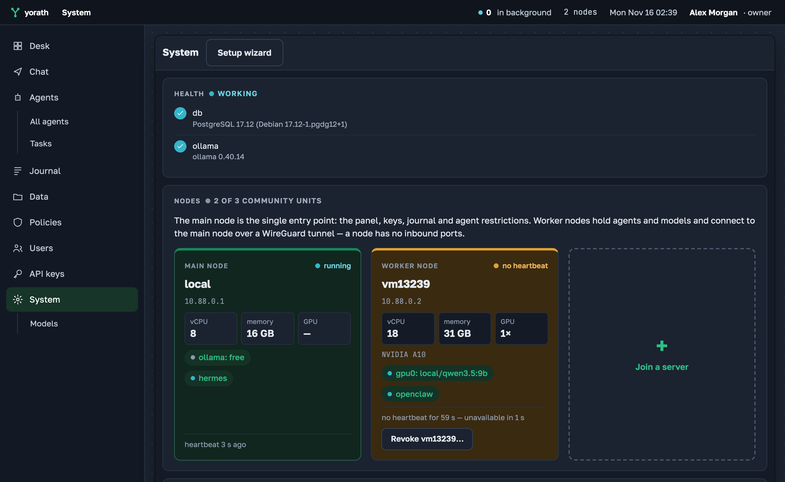

The second and third installs join the first one as worker nodes: the main node is the single entry
point (panel, `/v1`, keys, journal, agent restrictions), and the nodes hold agents and models. They are
linked by a WireGuard tunnel from the node to the main node; a node has no inbound ports open to the
internet, and the main node needs UDP 51820.

You need: a main node with Yorath installed, and a clean Ubuntu 24.04 x86_64 server for the node with outbound access to the main node's address (UDP 51820 and HTTPS).

## 1. Get a join token on the main node

```sh
yorath node token     # brings up the tunnel once, then prints the commands for the new server (valid for 24 h)
```

The same is in the panel: System → Nodes → "Join a server".

## 2. Install the node

On the new server, run the commands `yorath node token` printed. They install the **same release as the main node** and join it:

```sh
git clone --branch v<main node version> https://github.com/yorath-os/yorath.git /opt/yorath
sh /opt/yorath/installer/install.sh --join https://<main node address> <token>
```

The main node's version is in `yorath status`. A node of another version is refused.

## 3. Approve the node on the main node

```sh
yorath node list
yorath node approve <node name>
yorath agent add openclaw --node <node name>      # or Agents → "Connect agent" (or "Enable") → "Node"
```

It worked if `yorath node list` shows the node as `ready` and System → Nodes shows its card with a heartbeat.
If it didn't: `yorath node status` on the node shows the tunnel; `yorath doctor` on both servers names the problem.

## How a cluster works

**A node has no panel of its own, and you don't need one.** A worker node runs no database, core or
web panel and has no inbound ports: everything is done from the main node — System → Nodes in the panel
or `yorath node …`, `yorath agent …`, `yorath model …` in its terminal. On the node itself only SSH is
useful, for diagnostics: `yorath node status` shows the tunnel.

A server with GPUs gets its GPU driver for containers and one model server per card during the join;
how to put a model there is in [Models on cluster nodes](../models/on-cluster-nodes.md).

A node without a heartbeat for a minute is "unavailable" and its agents are `lost`; the rest keep
working, and it comes back on its own. To revoke a node: System → Nodes → "Revoke…" or
`yorath node revoke <name>`: the tunnel drops immediately. Disabling an agent, revoking its key and
cutting its internet work from the main node on any node.



Community allows up to 3 units: a node = 1, a node with GPUs = the number of GPUs, and the main node
counts. Nodes beyond the limit can't join (that's Enterprise); nodes already connected keep working.
