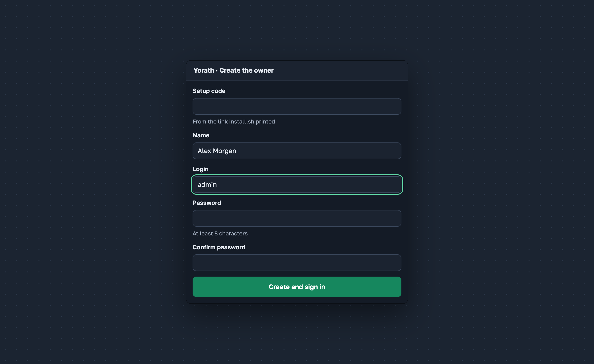
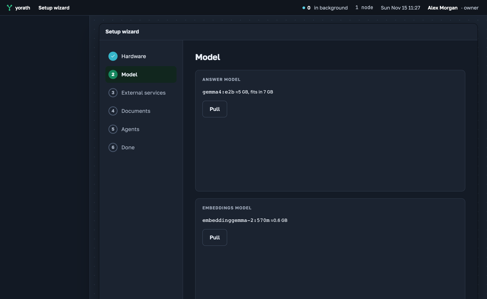
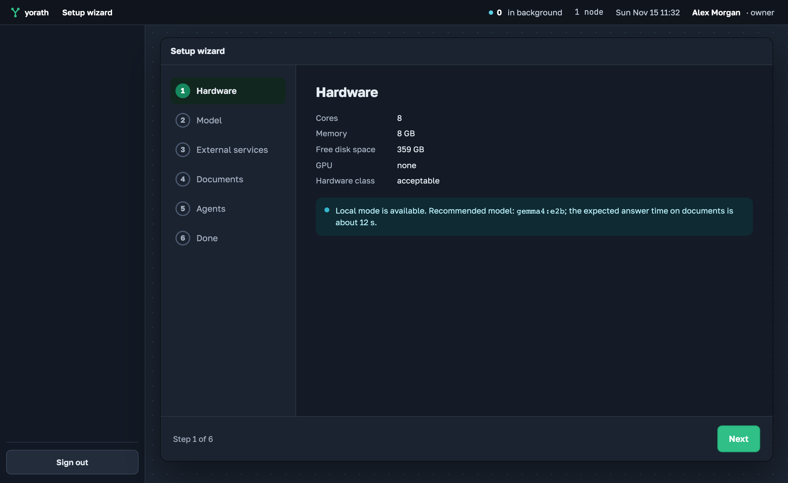
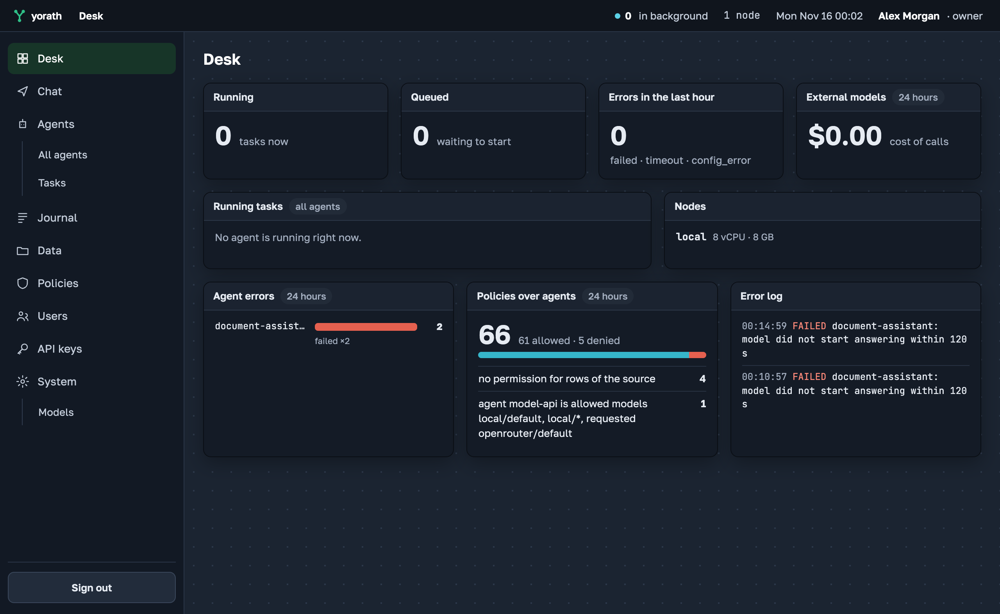
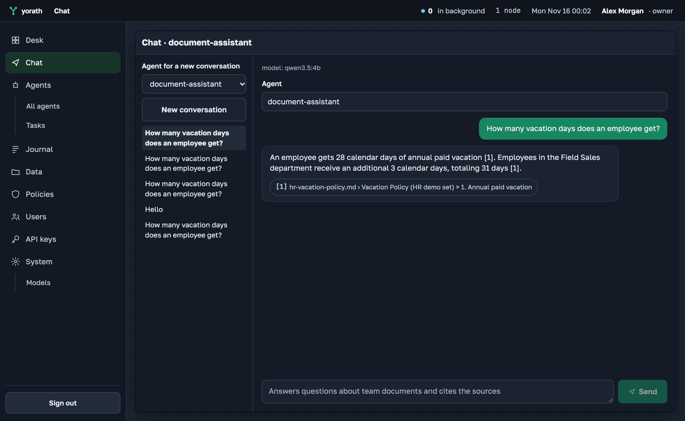
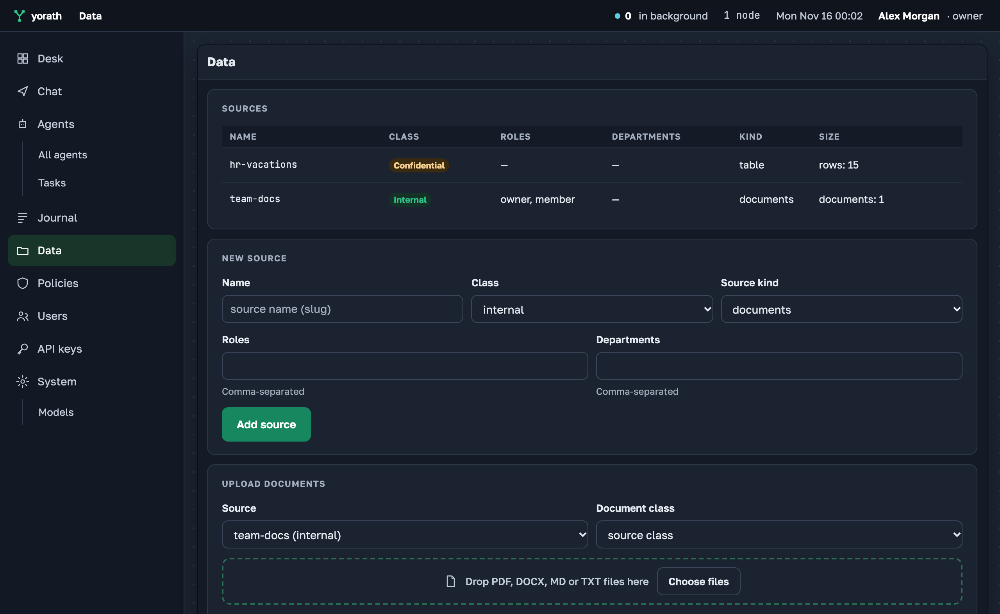
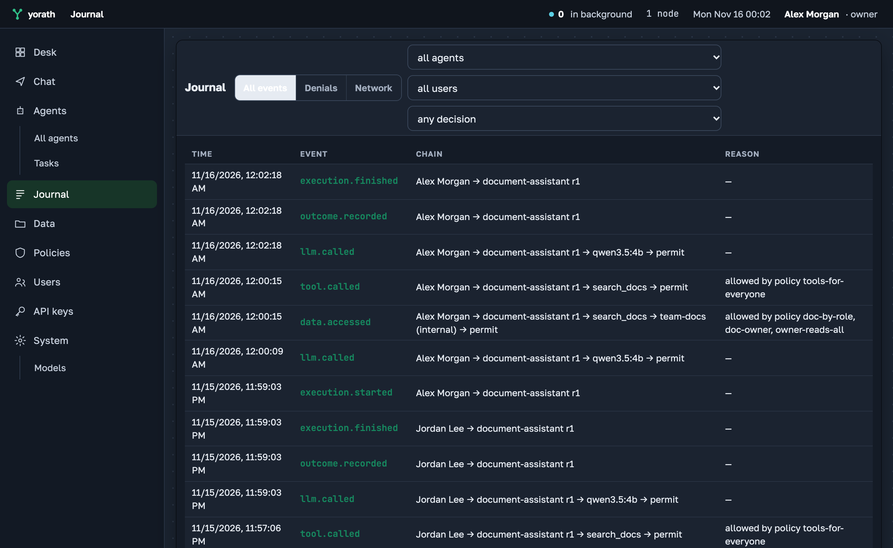
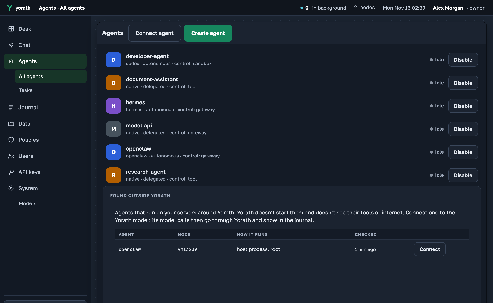
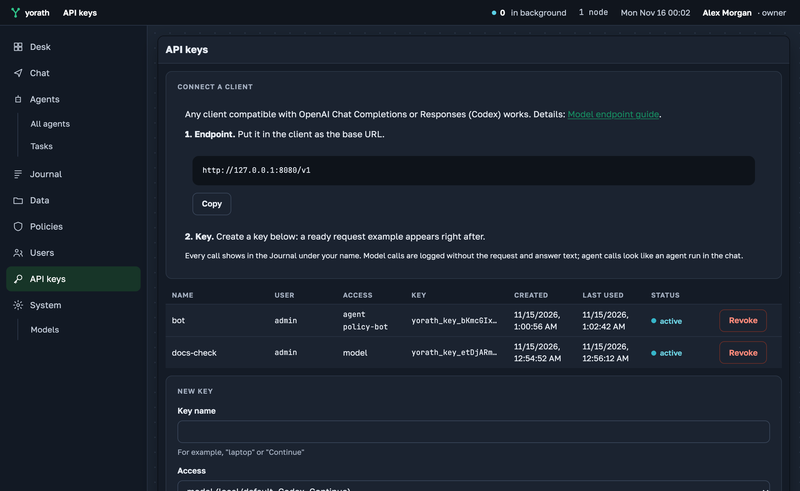

What to do between the link printed by the installer and a working system. Takes about 20 minutes, mostly pulling the model.

## Open the wizard

1. Open the link the installer printed. The browser warns that the certificate isn't trusted: Yorath issued it itself for the server's IP. Click "Advanced → Proceed".
   To get rid of the warning, trust the Yorath root certificate: see [Certificate](../operate/certificate.md).
2. Create the owner: a login and a password, typed twice ("Create and sign in"). Remember them: there is no password reset in the panel yet.
3. The wizard assesses the hardware and suggests local models (for answers and for document search). Click "Pull" for each and wait until they're done (a few minutes; if the tab closes, the download continues on the server).
4. If you have an OpenRouter key, enter it on the "External services" step and confirm that you agree to send data to an external model. You can skip this.
5. Click "Enable the HR demo set" and **save the passwords of the three demo users** — they are shown only once.

The installer prints a "how to open it in a browser" hint at the end, and `yorath status` and `yorath open` show it again at any time: the `scp` command for the certificate and how to trust it on macOS, Windows and Linux, an SSH tunnel in case ports are closed, and the URL with the setup code. If the server's ports 80 and 443 are closed, use an [SSH tunnel](../operate/certificate.md#ssh-tunnel).

## The main screens

The link printed by `install.sh` opens the owner screen: enter the setup code (it's already in the
link), a login and a password, then "Create and sign in".

The setup wizard then goes through Hardware, Model, External services, Documents, Agents and Done. On
the Model step, pull the answer model and the embeddings model; without both, local mode won't work.

On the Documents step, "Enable the HR demo set" creates a vacation policy, a vacation table and three
users with different permissions: `anna.parker` (employee), `max.lewis` (manager) and `olivia.newman`
(HRBP). Save their passwords: they are shown only once.

After the wizard, the owner lands on the Desk: running and queued tasks, errors, external model costs
and nodes.

In Chat, pick `document-assistant` and ask "How many vacation days does an employee get?" — the
answer cites the policy as `[1]`. Then sign in as each demo user and ask "How many vacation days does
Miller have left?": the answers differ according to each user's permissions.

Data holds the sources, documents and tables with their data classes and access rules.

Journal shows every run: the agent, model calls with tokens, access checks and denials. The Denials
and Network tabs filter by kind.

Agents → All agents lists the built-in and connected agents with their permissions; this is where you
edit an agent, create one from it ("Create from this") or connect OpenClaw and Hermes ("Connect
agent"). How to check each built-in agent: [Built-in agents](../agents/built-in.md).

API keys issues keys for the model or for a single agent and shows ready-made `curl` and Codex
snippets. See [API](../reference/api.md#your-api-key-and-how-to-keep-it-safe).

## Check that it works

- **Chat**: ask "How many vacation days does an employee get?" — the answer comes with citations from the policy.
- **Access control**: in another browser (or a private window), sign in as each demo user (`anna.parker`, `max.lewis`, `olivia.newman`) and ask "How many vacation days does Miller have left?" — the answers should differ according to their permissions.
- **Data**: documents and tables with data classes.
- **Journal**: every question shows up as an agent run with model calls and access checks.
- On the server: `yorath status` and `yorath doctor` — every line should be `ok`.

It worked if the chat answer has a citation, the demo users get different answers, and every line of `yorath doctor` is `ok`.

If it didn't: see [doctor and diag](../troubleshooting/doctor-and-diag.md).
